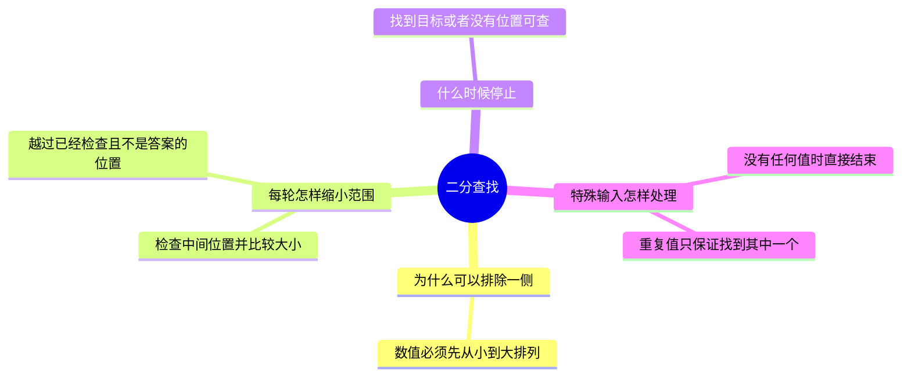

# 二分查找：每次排除不可能的一半

二分查找，是在已经按大小排好序的一组值中，每次检查中间位置，并根据大小关系排除一侧，直到找到目标或没有位置可检查的方法。本节使用从小到大排列的整数；相同的值可以重复出现。



假定你会 Python 的变量、列表和 if。变量是保存一个值的名字；列表是按位置存放的一组值；if 是根据条件决定执行哪段代码的语句。下面会就地解释其他需要的写法。

## 为什么必须先排好序

用 `[2, 5, 8, 12, 16]` 这组值来找 7。列表从位置 0 开始编号，所以上述 5 个值的位置依次是 0、1、2、3、4。位置编号和那个位置存放的值不是一回事，例如位置 2 存放的是 8。

先检查中间位置 2，那里是 8。因为列表已经按从小到大排列，8 右侧的所有值都至少和 8 一样大，因此也都大于 7。我们可以把位置 2 及其右侧全部排除，接下来只检查 `[2, 5]`。

如果数据没有排好序，中间值右侧也可能藏着 7，这样排除就可能把答案一起丢掉。因此排序条件是这一步推理的依据。

## 用两个位置记住还需要查哪里

用 `left` 表示尚未排除部分的最左位置，用 `right` 表示它的最右位置；两端都包含在接下来要检查的范围内。用 `mid` 表示本轮选择的中间位置。

当中间值小于目标时，中间位置及其左侧都可以排除，所以把 `left` 改为 `mid + 1`。当中间值大于目标时，中间位置及其右侧都可以排除，所以把 `right` 改为 `mid - 1`。这里加一或减一，是为了越过已经检查且确定不是答案的位置。

等到 `left` 大于 `right`，就没有剩余位置了。例如最左要检查位置 2，最右却只允许到位置 1，这时无法再选出一个同时满足两边要求的位置。

## 完整代码

函数，是给一组操作起一个名字，以便之后交给它数据并取得结果。下面的函数叫 `binary_search`。`numbers` 表示交给它的已排好序列表，`target` 表示要寻找的整数。

代码先用 `def` 定义函数。`len(numbers)` 得到列表包含多少个值，用来确定最后一个位置。接着用 `while` 表示“只要条件成立，就重复执行下面向右空出的那些代码行”。条件中的 `<=` 表示小于或等于，所以只剩一个位置时也会检查。

每一轮用 `//` 算中间位置：它先做除法，再取不大于结果的最近整数，例如 `3 // 2` 得到 1。因此位置总是一个整数。`numbers[mid]` 读取中间位置的值，`==` 检查这个值是否等于目标；`<` 和 `>` 则分别表示小于和大于。

找到时用 `return` 结束本次函数操作，并交回找到的位置。没找到时，根据比较结果改变一侧位置：`else` 表示前面 if 条件不成立时执行的另一种处理。没有任何位置可查时，交回 `None`，这是 Python 用来表示“这里没有结果值”的特殊值。最后的 `print` 把返回结果显示出来。

把下面内容保存为 `binary_search.py`，用 Python 3 执行 `python binary_search.py`。文件名只是保存这段代码的名称。

```python
def binary_search(numbers, target):
    left = 0
    right = len(numbers) - 1

    while left <= right:
        mid = (left + right) // 2
        if numbers[mid] == target:
            return mid
        if numbers[mid] < target:
            left = mid + 1
        else:
            right = mid - 1

    return None


print(binary_search([2, 5, 8, 12, 16], 7))
```

这里 `right` 初始值是列表长度减一，因为从 0 开始编号的 5 个位置，最后一个编号是 4。代码会显示 `None`，表示没有找到 7；找到时交回的是位置编号，而不是那个位置存放的数字。

## 跟着代码走一遍

第一次：`left=0`、`right=4`，所以 `mid=(0+4)//2=2`。位置 2 是 8，大于 7，于是把 `right` 改为 1。

第二次：`left=0`、`right=1`，所以 `mid=(0+1)//2=0`。位置 0 是 2，小于 7，于是把 `left` 改为 1。

第三次：`left=1`、`right=1`，所以 `mid=(1+1)//2=1`。位置 1 是 5，小于 7，于是把 `left` 改为 2。

现在 `left=2` 大于 `right=1`，没有位置可查，函数交回 `None`。每次没找到时至少排除刚检查过的位置，剩余位置数量不断减少，所以重复操作会结束。

空列表一开始就有 `left=0`、`right=-1`，不会进入重复操作。只剩一个位置时仍会检查一次，因为条件允许 `left` 等于 `right`。如果目标重复出现，这段代码返回其中一个位置，不保证是第一次出现的位置。

## 自检

把目标改成 12，第一次检查 8 之后，应保留哪一侧，新的 `left` 是多少？

参考思路：8 小于 12，已经检查的位置及其左侧都不可能是目标，应保留右侧，把 `left` 改为 3。下一轮中间位置为 3，那里正是 12，函数返回位置 3。
