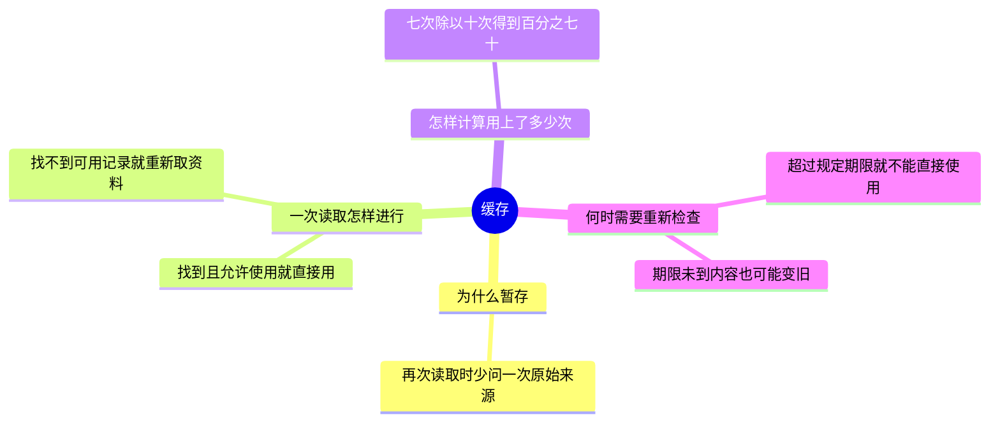

# 缓存：把常用资料暂存在手边

缓存（cache），是把已经取得的资料另外留一份在更方便读取的地方，以便下次需要时先找这一份。这里“更方便”可能表示读取更快，也可能表示不必再次通过网络向另一台电脑询问。它不是新的原始资料，而是一份暂存的副本。

本节只需要基础算术。读完后，你应能解释一次读取怎样进行、算出暂存资料被用上的比例，并说明为什么读得快也可能读到旧内容。

## 先看一次读取会发生什么

假设购物软件要显示某本书的价格。商店保存的当前价格是 40 元。软件第一次问到这个价格后，另外记下一份“40 元”；下次显示这本书时，可以先检查这一份记录。

缓存命中（cache hit），就是本次要找的资料在缓存里找到了，并且按当前使用规则可以直接使用。比如第二次查看这本书时，软件找到仍被允许使用的价格记录，就可以直接显示 40 元。

缓存未命中（cache miss），就是本次不能从缓存得到可直接使用的资料。原因可能是根本没有这本书的记录，也可能是记录已不被允许继续使用。此时软件仍需向商店取得价格，才能回答这次查询。取得结果后是否暂存，则取决于软件的具体规则。

缓存之所以可能节省时间，是因为命中时省去了再次询问商店的过程。它不是每次都更快：如果没找到，仍需要询问商店，还多做了一次缓存检查。

## 怎样计算用上缓存的比例

命中率（hit rate），是所有读取中，发生缓存命中的次数所占的比例。它衡量“有多少次用上了缓存”，不直接表示每次节省了多少时间。

假设下面是 10 次读取的结果：

| 读取次数 | 1 | 2 | 3 | 4 | 5 | 6 | 7 | 8 | 9 | 10 |
| --- | --- | --- | --- | --- | --- | --- | --- | --- | --- | --- |
| 是否命中 | 是 | 是 | 否 | 是 | 是 | 否 | 是 | 是 | 否 | 是 |

用 H 表示命中的次数，本例 H=7。用 N 表示总读取次数，本例 N=10；N 必须大于 0，否则没有读取可以拿来计算这个比例。

因此，命中率为 H/N=7/10=0.7，也就是 70%。这里用全部 10 次读取作为比较范围，不是仅把找不到的 3 次拿来比较。这个结果也不能推出“整体速度提高了 70%”，因为我们还不知道每次读取花了多长时间。

## 为什么资料找到了，也可能已经不对

沿用价格的例子。软件暂存 40 元以后，商店把真实售价改为 45 元。如果软件没有得知这次变化，仍然使用原来的那份记录，用户看到的就是旧价格。

缓存过期（expiration），是指按照软件规定的使用期限或其他失效规则，这份暂存资料已经不应直接使用。比如软件规定一份价格最多使用 3 分钟，那么超过 3 分钟后，再次看到这条记录也应该重新向商店取价，或按明确设计的规则处理旧内容。

“过期”和“内容已经变旧”不是同一件事。商店可能在第 1 分钟就改价，此时记录还没超过 3 分钟，但内容已经旧了；也可能 3 分钟过去价格都没变，此时记录虽然过期，数字却仍然正确。期限只是决定何时重新检查的一条规则，不能保证期限内价格绝不会变化。

所以问题不在于“缓存存在”本身，而在于软件是否允许这类资料暂时与原始记录不同，以及在什么时候检查变化。显示可稍后更新的资料与确认付款价格，通常需要不同的处理要求；本节不据此假定某个具体软件采用了哪一种方案。

## 回顾与自检

一次读取先检查暂存资料，能按规则使用就是命中，不能使用就是未命中。命中率统计的是次数比例；要判断读取是否正确，还必须考虑原始资料有没有变化。

问题：某软件 20 次读取中有 15 次命中。命中率是多少？如果商店刚刚改价，较高的命中率能否证明软件显示的价格正确？

参考思路：15/20=75%。这只能说明 75% 的读取使用了缓存，不能证明缓存内容与商店当前价格相同。

材料说明：价格和读取记录均为讲解用的虚构例子。本节覆盖基本读取流程、命中与未命中、命中率和过期含义，不讨论具体产品的实现。
