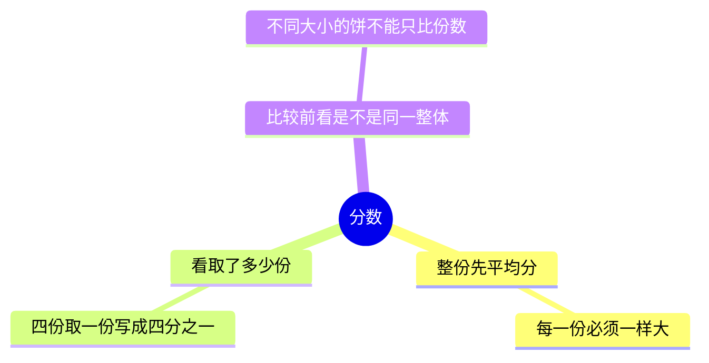
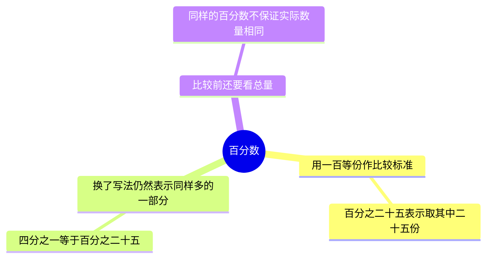

# 用分一块饼理解一部分有多少

## 导读

这份讲义只需要基础算术。先看怎样表示一块饼中的一部分，再看怎样换成统一的比较方式。两章正文之后有一道自测题和答案。

## 第一章：分数

分数，是把一整份平均分成若干等份后，表示取了其中多少份的一种写法；平均分就是每一份一样大。

### 怎样读出取了多少

把一块饼平均切成 4 份，拿走其中 1 份，可以写成 `1/4`，读作“四分之一”。在这种同行写法中，`/` 左侧写取走的份数，右侧写整块饼被平均分成的总份数：这里 1 表示拿走 1 份，4 表示整块饼被平均分成 4 份。

如果拿走 3 份，就写成 `3/4`。先确定所有份一样大，才能用这样的份数直接说明取了整块饼的多少。

### 比较时为什么还要看整块饼

大饼的 `1/4` 与小饼的 `1/4` 都是各自整块的四分之一，但两份饼的实际大小不一定相同。因此，“取了整块的多少”与“拿到的实际大小”需要分开看。

## 第二章：百分数

百分数，是把一整份统一看成 100 等份后，表示其中多少份的写法；符号 `%` 表示“百分之”，例如 `25%` 表示一百等份中的 25 份。上一章的四分之一表示平均分成四份、取其中一份，下面把这同一部分换成百分数。

### 从四份换成一百份

先把一块饼平均分成 4 大份，再把每大份平均分成 25 小份，整块饼就有 `4 × 25 = 100` 小份。这里 `×` 表示乘法，`=` 表示两边代表的数量相等。原先的 1 大份相当于 25 小份，所以 `1/4 = 25/100 = 25%`；与上一章一样，`/` 左侧是取走份数，右侧是平均分成的总份数。

换了表示方式，拿走的饼并没有变。与上一章一样，大饼的 `25%` 和小饼的 `25%` 仍不一定有同样大的实际面积。

## 自测题

把同一块饼平均分成 4 份，取其中 3 份。分别怎样用前两章的写法表示？为什么两种写法表示的是同样多的饼？

## 答案

写成分数是 `3/4`，写成百分数是 `75%`。因为每大份再分成 25 小份后，整块共有 100 小份，拿走的 3 大份共有 `3 × 25 = 75` 小份。整块饼和拿走的部分都没有改变，只是计数时每一份变小了。
